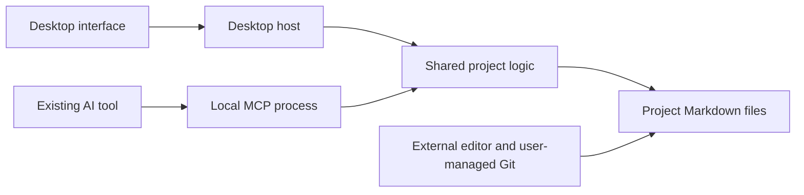

# Project Workspace — Technical Design

Status: Technical design v0.3, based on [Product Specification v0.18](project-workspace-spec.md). Electron, TypeScript, React, and Mantine are accepted stack choices. Supporting packages below are recommendations; other unconfirmed implementation details remain proposals. No application, dependencies, or prototype have been created.

## 1. Recommended architecture

Use a desktop app and a separately launchable local MCP server, sharing one library of project operations. Markdown files remain authoritative. Start with file reads and an in-memory index; a database, hosted backend, internal AI runtime, and always-running service are unnecessary for the initial workload.



The shared logic is a library loaded into two processes, not a new network service. It owns parsing, project boundaries, record validation, dependency readiness, change detection, and file writes. The desktop renderer receives narrow operations through the host; it does not receive unrestricted filesystem or shell access. Sanitize rendered Markdown/HTML, disable scripts from document content, and deny document-driven navigation or new windows. Resolve internal relative links through the validated project boundary; reject arbitrary `file:`, `javascript:`, `data:`, and custom-protocol links. Open only allowlisted HTTP/HTTPS external links on an explicit user action. These controls must cover both preview and editor rendering.

The MCP host launches the server through stdio and keeps the process alive for its connection. Each operation reads current project state; closing the desktop window does not affect that connection. This is the standard client-launched subprocess model described in the [official MCP stdio specification](https://github.com/modelcontextprotocol/modelcontextprotocol/blob/main/docs/specification/2026-07-28/basic/transports/stdio.mdx). Logs go to stderr. Do not implement protocol framing by hand; use an official SDK version verified against the chosen clients.

### Observing MCP status from the window (2026-09-19)

The window cannot see the server. The client owns the process and both ends of
the stdio pipe, so there is no handle, port, or channel the window could inspect.
The only thing the two processes reliably share is the project folder, so the
server records its own liveness there and the window reads it: a small JSON file
per session under `.projectspace/runtime/sessions/`, refreshed on a timer and
removed on a clean exit. It is coordination state like the write lock, excluded
from Git, and never project content.

Three separate facts come out of this, and the UI keeps them apart because they
can disagree and a user debugging a client needs to know which one failed:

| Fact | Evidence | What it does not prove |
| --- | --- | --- |
| Bundled runtime present | The window checks its own installed resources | That anything is running |
| Server process running | A session record with a current heartbeat | That a client ever connected |
| Client connection open | The server marked the record when the opening handshake ran | That the connection is still useful this second |

A heartbeat that has stopped makes a record *stale*, never *stopped*: it proves
the recording stopped, not that the client did. An unreadable folder reports
Unknown. Records abandoned by a killed process are cleared by the next server to
start, because reading status must never write to the user's project.

**Start and Stop are not offered, by design.** A server the window launched would
have no client on the other end of its pipes, so it could not serve anyone;
stopping the client's own process would sever a connection from outside the
client's knowledge and leave it believing the tool is still there. Both would be
theatre. The footer says the client owns the lifecycle and gives connection
guidance instead. Making the buttons real would need a different transport and a
long-lived service, which decision D-008 and section 1 deliberately rule out;
that is a bigger change than an indicator warrants.

A server bound to a folder that is not a project yet records nothing, because
creating the heartbeat directory would leave `.projectspace/` non-empty and make
`project_initialize` refuse the folder as somebody else's. The check runs on each
heartbeat rather than once at startup, so a project created through MCP becomes
observable within one heartbeat instead of needing the client to reconnect.

The cost of this approach is that only *our* server is observable. A client
running some other build against the same folder is invisible and reads as no
connection, which is why the wording is "no running server was observed" rather
than a claim about the world.

## 2. Accepted stack and supporting packages

The user accepted **Electron + TypeScript + React**, with a separately launched Node-based MCP host sharing the project logic. Milkdown remains the selected editor candidate, subject to the Markdown-preservation check. Desktop framework selection is settled; packaging is routine implementation and release-validation work.

The user accepted **Mantine** as the UI library, using its maintained components and a small theme/CSS layer. Its AppShell provides the main layout, Select supports searchable choices, and its theme centralizes colors, typography, spacing, and other visual decisions. Start with core components and hooks; add optional packages only when a feature needs them. [AppShell](https://mantine.dev/core/app-shell/), [Select](https://mantine.dev/core/select/), [theme](https://mantine.dev/theming/theme-object/)

| UI option | Assessment for this project |
| --- | --- |
| Mantine | Accepted: ready-made application controls with less locally maintained component code. Still requires deliberate layout and accessibility testing. |
| shadcn/ui | Good for owning and heavily customizing component source; that ownership adds local maintenance. Prefer it if bespoke component behavior becomes more important than using a maintained kit. |
| MUI | Broad component coverage with a Material Design baseline. A reasonable alternative, but Mantine is the better fit for the proposed visual flexibility and low-maintenance workflow. |

The comparison is a design judgment grounded in the projects' documented approaches: [shadcn/ui introduction](https://ui.shadcn.com/docs), [Material UI](https://mui.com/material-ui/). Do not install multiple UI kits or a second styling system for the initial shell. Use Mantine's theme and CSS modules for custom layout. Keyboard navigation, labels, focus management, and Kanban interaction still need testing.

Milkdown handles Markdown editing separately from the UI kit. Its GFM preset includes tables and related Markdown structures. Tiptap Markdown remains a fallback if the preservation experiment rules Milkdown out. Kanban drag-and-drop is handled separately, with dnd-kit recommended below. [Milkdown GFM preset](https://milkdown.dev/docs/api/preset-gfm), [Tiptap Markdown](https://tiptap.dev/docs/editor/markdown/getting-started/basic-usage)

### Supporting-package shortlist

These are feature-specific recommendations, not installed dependencies or a requirement to install everything at scaffolding. Resolve compatible versions together when implementing the relevant feature.

| Package | Purpose and boundary |
| --- | --- |
| `@dnd-kit/react` | Move and reorder Kanban cards. The current React API supports sortable interaction; add `@dnd-kit/helpers` only if its move helper is used. Pin the selected version and test keyboard movement plus multiple columns; provide a status control as an alternative to dragging. [Current quickstart](https://dndkit.com/react/quickstart/) |
| `@modelcontextprotocol/server` + `zod` | Official MCP server implementation plus one shared validation library for tool inputs and app-owned file records. Current SDK v2 supports Standard Schema; Zod v4 is our proposed choice, not a protocol requirement. Reuse validation across UI-host and MCP entry points. [Official SDK](https://github.com/modelcontextprotocol/typescript-sdk) |
| `yaml` | Parse YAML frontmatter and edit owned metadata fields through its Document API, retaining unknown fields instead of reconstructing a restricted object. Document serialization is not byte-preserving; keep untouched source bytes and test any deliberate rewrite. This library alone does not satisfy the Markdown-preservation requirement. [Document API](https://github.com/eemeli/yaml/blob/main/docs/04_documents.md) |
| `chokidar` | Refresh the desktop view after external edits and Git changes. Watch only relevant paths, coalesce events, and close watchers when a project closes. Atomic-save handling helps with editor saves, but events never replace revision checks or conflict handling. [Official README](https://github.com/paulmillr/chokidar) |
| `@tabler/icons-react` | One consistent icon set for navigation, ticket states, and editor controls. Import the icons actually used. [React documentation](https://docs.tabler.io/icons/libraries/react) |

Use **electron-vite** for desktop development/building and the already proposed **electron-builder** for distribution. They have distinct roles; verify the separate MCP build output is included as resources. [electron-vite guide](https://electron-vite.org/guide/)

Use **Vitest** for shared validation, transitions, dependency readiness, and filesystem/editor preservation tests. Consider **Playwright** for a small set of complete desktop workflows once the app runs; its Electron automation is explicitly experimental and does not replace packaged cross-platform checks. [Vitest](https://vitest.dev/guide/), [Playwright Electron support](https://playwright.dev/docs/api/class-electron)

For any renderer path that inserts generated HTML, **DOMPurify** is a sanitizer candidate to assess with Milkdown's actual rendering pipeline. Do not add a duplicate Markdown renderer solely to use it. Sanitization does not replace the link/navigation restrictions in section 1. [DOMPurify](https://github.com/cure53/DOMPurify)

React state is sufficient initially; defer a global state library until shared UI state makes it necessary. Keep simple text search and Node's filesystem, path, UUID, and hashing APIs. No database, ORM, AI-provider SDK, or separate UI styling framework is needed for the current design. Select locking/safe-write helpers during the filesystem experiment if native operations do not meet the defined behavior; this shortlist is not a complete dependency manifest.

### Packaged MCP: recommended simple path

Ship a platform/architecture-specific **Node runtime plus the compiled MCP server and required assets** as app resources outside Electron's ASAR archive. The AI client directly starts that runtime with the server path and project root as arguments. The user does not need a separate Node installation, running GUI, network listener, or background service. Electron-builder documents `extraResources` for executable tools and other runtime files, including their resource locations on each platform. [Application contents](https://www.electron.build/docs/contents/)

Illustrative client launch fields (not a universal client configuration or a command executed here):

```json
{
  "command": "<installed-resources>/mcp/node[.exe]",
  "args": ["<installed-resources>/mcp/server.mjs", "--root", "<selected-project>"]
}
```

Use a compiled/bundled JavaScript entry point with any required runtime assets beside it. The shared TypeScript project logic is bundled into both applications; there is no need for a separate deployed service. Electron-builder is the proposed packager for this route, not an installed dependency.

Two alternatives are viable but unnecessary initially:

- **Reuse Electron's bundled Node:** `ELECTRON_RUN_AS_NODE` starts Electron in Node mode, provided its `runAsNode` fuse is enabled. This avoids shipping another runtime but couples MCP launch to Electron's executable, environment settings, and packaging flags. [Electron environment variables](https://www.electronjs.org/docs/latest/api/environment-variables), [fuses](https://www.electronjs.org/docs/latest/tutorial/fuses)
- **Node single-executable application:** embeds the bundled server into a Node executable. This can simplify the file layout, but the official documentation still labels the feature as active development. It is not required to ship a self-contained installer. [Node single-executable applications](https://nodejs.org/api/single-executable-applications.html)

The remaining checks are ordinary distribution details: choose the correct runtime for each target, preserve executable permissions and signing, keep the configured launch path valid across updates, and verify clean stdio/shutdown behavior with the GUI fully exited. For a Linux portable format with a transient mount path, install the helper at a persistent location or choose a stable installed layout; do not put a transient mount path into the client's saved configuration. The small cost of the simple route is an additional runtime to ship and maintain with app releases.

Exact dependency versions, OS versions, CPU architectures, and Linux package targets remain release decisions. Documentation establishes this packaging approach; an actual packaged build has not been tested yet.

## 3. Portable project storage

Propose one reserved folder, provisionally named `.projectspace/`. It contains app-owned Markdown records; existing documentation stays wherever it already lives in the repository.

```text
repository/
  README.md                         existing source document
  docs/architecture.md              existing source document
  .projectspace/
    project.md                      identity, included paths, board order
    tickets/<stable-id>.md           one canonical file per ticket
    documents/<stable-id>.md         metadata pointing to an existing document
    reviews/<record-id>/<id>.md      historical human-reviewed snapshots
```

Folder names are proposals. Project creation adds the reserved folder only when absent and never overwrites an existing unrelated directory. Initialize into a temporary staging directory, validate it, and publish it as a unit where supported; recover or report interrupted initialization explicitly.

- `project.md` has versioned YAML frontmatter for `schema_version`, a generated project UUID, name, included relative files/folders, and an optional `backlog_order` list of ticket IDs. Its Markdown body can hold a project introduction.
- Each ticket has a stable generated UUID independent of filename, title, and path. UI may abbreviate it when unambiguous. Avoid shared sequential ID counters across Git branches.
- Existing-document metadata holds its stable ID and project-relative path. It does not copy the live document body or modify the document's existing frontmatter just to register it. Manifest inclusion is authoritative for what appears in the workspace; listings can resolve included source files without metadata records.
- Review snapshots are historical evidence of what the user reviewed, not another editable source of current content. Create one on explicit human content review, not on every save. Preserve the source and enough metadata to identify the record, review time, and revision.
- Store local checkout paths, window position, and recent-project preferences outside the repository as disposable app state. These are not project content and need not be Markdown. Runtime locks and temporary saves are likewise non-authoritative.

`documents_include` updates only the manifest. Create per-document metadata later when an operation needs a stable document reference or review record, under the shared write lock. Find an existing mapping by canonical in-project path before creating one; repeated registration is idempotent. Persist metadata before emitting its stable ID or writing a ticket link to it. An interruption can leave unused metadata, but must not make included source files disappear. Report invalid/missing source paths without deleting metadata or touching the sources. Do not make manifest inclusion depend on successful creation of a second file.

Use relative paths within project records. Resolve and validate real paths at runtime; reject traversal, symlinks/junctions escaping the selected root, and invalid platform filenames. Detect case-colliding paths before claiming portability. Never execute scripts or commands from project frontmatter. Preserve unknown metadata fields and refuse unsupported schema versions without rewriting files.

Git operations remain external. Detect conflict markers and invalid records, preserve their bytes, and show an actionable problem. App writes to invalid records stop until the user resolves them. Rebuild views after external changes; do not infer a different branch is synchronized or approved.

## 4. Project selection and checkout identity

Persist a logical project UUID in `project.md`. A clone or worktree retains that UUID, but each local checkout has its own canonical root path and current files. Never silently combine two checkouts because their project UUID matches.

Propose an explicitly root-bound MCP connection, such as `projectspace-mcp --root <selected-folder>`. The name and command are illustrative. The root is selected during setup, not taken from an arbitrary path supplied by the model on each call. `project_initialize` can initialize that selected folder even if it has no project records yet. Project discovery and local path bindings do not grant access to other roots.

Show project name and checkout identity in responses. Switching the visible UI project must not redirect an already-running MCP connection. A local recent-project registry can list multiple checkouts, with the user choosing the right path. Setup convenience for several projects is a follow-up design detail; do not depend on client-specific workspace-root behavior without validating it.

## 5. Ticket state and ordering

Suggested frontmatter fields: `schema_version`, `id`, `title`, `status`, `depends_on`, `created_at`, `updated_at`, `related_documents`, optional blocker details, and optional completion provenance. The body stays Markdown for the description, acceptance criteria, implementation notes, and handoff information. A template suggests headings; the app must not require particular prose headings to display the ticket.

Use four status values: `backlog`, `in_progress`, `verification`, `done`. Keep content-review information separate. A ticket with no prerequisites is dependency-ready; otherwise every prerequisite must be in Verification or Done. Missing references, duplicate IDs, and cycles prevent the affected ticket from being suggested as eligible and produce an explanation.

`backlog_order` in the project manifest defines manual order. Tickets absent from that list follow deterministically by creation time and stable ID. Creating a ticket therefore needs only one new file; it need not also update a shared counter or order file. Reordering edits only the manifest. Report duplicate/unknown order entries without deleting ticket content.

The next-ticket query returns the first Backlog ticket in that order whose prerequisites satisfy readiness and which has no explicit blocker or invalid record. It does not reserve or start it. On the user's request, the external agent reads its linked context and changes it to In progress. Revalidate eligibility at that mutation. One active AI session per project is the initial usage assumption; there is no automatic execution queue.

If a prerequisite fails verification, persist an issue on that prerequisite and derive an affected-work flag for dependent tickets. Existing downstream statuses stay intact. Proposed default: do not suggest new affected work until the prerequisite is corrected or the user explicitly resolves the issue. This failure flag takes precedence over a still-Verification status. Direct overrides and reopening Done tickets need explicit transition rules during implementation design.

## 6. Human completion through the existing AI tool

Keep completion separate from ordinary status mutation. A dedicated `ticket_record_user_completion` operation requires the current ticket revision, an assertion that the user explicitly instructed completion, and a brief description of that instruction. It is valid from Verification. The app can also record completion through a direct user action.

Record the decision source separately from the recorder. For example, an agent-recorded update says `decision_source: reported_user_instruction` and `recorded_by: agent`; it must not pretend to be a direct UI action. Store a timestamp and the accepted ticket revision. Keep test results as supporting information, not authorization. Avoid storing entire conversations just to record completion.

The server can validate transition structure and require the explicit assertion. It cannot independently prove the conversation occurred or prevent a file-writing agent from changing Markdown directly. This is a cooperative workflow rule backed by provenance, not a tamper-proof approval system. The companion instructions must clearly prohibit self-certification. A second approval in this app is not part of the design.

Generic ticket/document mutations must not bypass the completion operation, including attempts to create a new ticket already marked Done or edit managed frontmatter through a body-update tool. External Done edits with missing or inconsistent provenance are displayed as externally changed/unattributed; do not invent approval, silently change their status, or erase the user's files. A forged matching assertion remains outside the guarantee of this local design.

## 7. Meaningful changes and review history

Use two separate comparisons:

- **Raw revision:** a hash of exact file bytes used for stale-write detection. Formatting differences must still cause a write conflict if a caller read older bytes.
- **Review comparison:** structured Markdown content and relevant metadata compared with the last reviewed snapshot. Known representation-only changes can be ignored here. Code text, link destinations, headings, substantive frontmatter, and acceptance criteria must remain significant.

No-op opens never save. Ticket status, ordering, and bookkeeping timestamps do not by themselves invalidate review of its intended work. A user completion decision does not automatically review linked documents.

Deterministic parsing can identify some formatting equivalence; it cannot reliably distinguish every typo correction, rephrasing, or change of intent. Proposed handling: ignore known formatting-only changes, show unclassified changes against the previous reviewed version, and allow the user or cooperating external AI to explain their significance. Meaningful changes set content to Unreviewed while preserving the prior snapshot. Do not show unclassified current content as fully human-validated merely because an older revision was reviewed.

This classification behavior needs a short prototype review: it is the main unresolved product-sensitive detail. Do not add an embedded model, paid classification service, or assume an AI-provided label is infallible. The source diff remains available for inspection.

## 8. Saving without losing work

All desktop-host and MCP mutations call the same write path:

1. Resolve the target inside the bound project and acquire a short per-checkout write lock shared by app and MCP processes. Keep this temporary coordination outside Git-tracked content.
2. Re-read the target and compare its exact revision with `expected_revision`; create operations require the path to be absent.
3. Validate schema and transition rules. For dependency-sensitive writes, re-read related records under the same app/MCP lock.
4. Save through a temporary file in the target directory and replace using the platform-supported safe operation. Release the lock after success or failure; report errors without truncating the original.

Return the new revision and a concise description of the applied change. Reads return revision tokens. A stale write returns the latest revision and a conflict result so the caller can re-read; it must not silently retry by overwriting newer content.

External editors and Git do not honor these locks. Rechecking files reduces races but does not create a universal filesystem transaction. Watchers trigger refreshes; they are not proof that a buffer is current. A dirty editor shows a conflict and preserves the unsaved buffer. Prototype rapid external saves, rename/replace behavior, and a crash during save before claiming no-loss behavior.

Favor single-record operations. For a review snapshot, write the self-contained snapshot first; derive the latest review from valid snapshots rather than requiring an atomic pointer update elsewhere. For other future multi-file actions, define recovery before exposing them. Do not build a general transaction engine in advance.

## 9. Initial MCP surface and workflow guidance

These are proposed operations, not finalized tool schemas:

| Operation | Purpose |
| --- | --- |
| `project_initialize` / `project_get` | Initialize the selected root or retrieve its identity and compact context index. |
| `documents_include` | Register selected in-root documents/folders in place. |
| `document_read` / `document_write` | Read original Markdown plus revision, or save with a revision precondition. |
| `project_search` | Bounded text/title search across included docs and tickets. |
| `ticket_list` | List filtered tickets, dependency reasons, or the next eligible candidate. |
| `ticket_create` / `ticket_update` | Create or update task content and ordinary lifecycle fields with validation. |
| `ticket_record_user_completion` | Record the user's explicit completion instruction with honest provenance. |

The minimal read surface returns metadata/snippets by default and full content on request. Ticket reads include direct document references and prerequisite statuses. Use simple text search initially; add embeddings only if measured retrieval failures justify them. Managed metadata is changed through validated record operations, not unrestricted whole-file writes.

Ship portable Markdown workflow guidance, with a skill package for clients that support it after validation. It explains: read context, distinguish observed facts from assumptions, choose/start work only when asked, leave results in Verification, record Done only on explicit user instruction, and preserve useful handoff notes. An MCP connection does not itself enforce that behavior. Keep guidance distinct from project evidence and data-validation rules.

## 10. Formatted editor boundary

Keep the source file as the canonical document. Retain original bytes, separate any existing frontmatter without rewriting it, and parse only for display/editing. Use one editor candidate initially.

- Support a declared CommonMark/GFM subset first: headings, lists, links, fenced code, tables, and other syntax proven by the fixture tests.
- Do not serialize on load or save merely because the editor normalized its internal representation.
- On deliberate edits, preserve unrelated content and original metadata. If a library rewrites too much, it fails the fixture rather than redefining the requirement.
- Detect unsupported constructs before editable rendering. Show a readable fallback and an Open in external editor action when lossless saving cannot be established. Never silently drop HTML, directives, extensions, or unknown blocks.
- Keep a built-in source editor optional. The external-editor fallback is sufficient for the initial experiment.

Unsupported-content detection itself must be tested. A parser producing an AST does not establish that the editor can serialize that content safely.

### Preservation research evidence

Upstream reports confirm that content-preservation failures have occurred. This is issue/documentation research, not a reproduction against our selected package versions:

- **Inline line breaks removed:** issue #2428 reports `foo<br>bar` becoming `foobar` with preset-commonmark 7.21.3. The issue is closed and fix #2463 was merged August 29, 2026. Verify the selected release includes it rather than treating the historical report as an unfixed limitation. [Report](https://github.com/Milkdown/milkdown/issues/2428), [merged fix](https://github.com/Milkdown/milkdown/pull/2463)
- **Autolink backslashes multiply:** issue #2349 reports repeated parse/save cycles doubling certain backslashes inside autolink URLs with Crepe/transformer 7.20.0. Both Milkdown's issue and the linked underlying serializer issue were open when checked. This is a specific URL edge case, not evidence that all links are affected. [Milkdown report](https://github.com/Milkdown/milkdown/issues/2349), [upstream report](https://github.com/syntax-tree/mdast-util-to-markdown/issues/73)
- **Inline code altered while typing:** issue #2446 reports emphasis input rules consuming literal characters inside code spans on 7.22.0. Loading the same complete Markdown worked; incremental typing triggered the bug. Fix #2445 was merged August 8, 2026. Include typing interactions alongside import/export checks. [Report](https://github.com/Milkdown/milkdown/issues/2446), [merged fix](https://github.com/Milkdown/milkdown/pull/2445)

Milkdown documents conversion through Remark AST and ProseMirror, plus configurable stringify options. These support controlled output formatting, not a documented guarantee of byte-identical source preservation. [Architecture](https://milkdown.dev/docs/guide/architecture-overview), [FAQ](https://milkdown.dev/docs/guide/faq)

Recommendation: keep Milkdown as a candidate and test these exact cases, frontmatter, tables, code, and unsupported extensions against the chosen version/configuration. Preserve frontmatter outside the editable body where appropriate. Distinguish harmless Markdown normalization from changed content or meaning; exact unrelated whitespace preservation should be evaluated as a separate usability goal. This research does not approve a relaxation of the existing product requirements or select a replacement editor.

## 11. Validation before building out the product

| Experiment | Required evidence |
| --- | --- |
| Independent packaging | On Windows, macOS, and Linux, invoke the bundled Node/server through the saved client command with the GUI fully exited and no system Node dependency. Read/write a fixture project, reconnect, and confirm the configured path survives an app update. |
| Markdown preservation | No-op open is byte-identical. A small supported edit preserves existing frontmatter, code, tables, links, and unrelated text. Unknown syntax survives or saving is explicitly blocked. |
| Safe writes | Stale app/MCP writes conflict; dirty UI buffers survive external edits; failures preserve original files. Document residual races with uncooperative external writers. |
| Review classification | Formatting-only edits retain review; meaningful changes require renewed review; ambiguous edits remain visible without claiming current human validation. |
| Completion and dependencies | Generic writes cannot self-certify Done; explicit user instructions can be recorded. Verification unlocks dependents; failed prerequisites flag affected work without resetting it. |
| Portable checkout | Clone/open the same project at a new path; preserve identity, selected docs, review history, and board state while keeping checkout bindings separate. |
| Inclusion and rendering | Interrupt inclusion/registration between writes: included files stay visible and repeated registration does not duplicate IDs. Verify unsafe links/HTML cannot execute or navigate, while validated internal links remain usable. |

These checks have not run. Use a small editor-preservation experiment and a packaging smoke test as early implementation work, then implement one vertical slice: initialize project → create ticket → implement externally → Verification → user instruction → Done. Add the remaining Mantine UI around that verified path. The packaging test verifies a known distribution pattern; it is not a reason to reopen the accepted desktop stack.

## 12. Next decisions

For deferred distribution work, see [releases after merge](release-automation.md):
current packaging evidence, tooling alternatives, a proposed GitHub Actions
build-and-publish sequence, and release acceptance criteria. No workflow is
enabled by that proposal.

The base stack and Mantine are accepted. Supporting packages remain recommendations to add as their features are implemented. Review the proposed reserved Markdown-record layout, then choose how to present ambiguous review changes. Other details can be refined through implementation checks without another long product questionnaire. The product spec remains authoritative wherever this proposal leaves a choice open.
