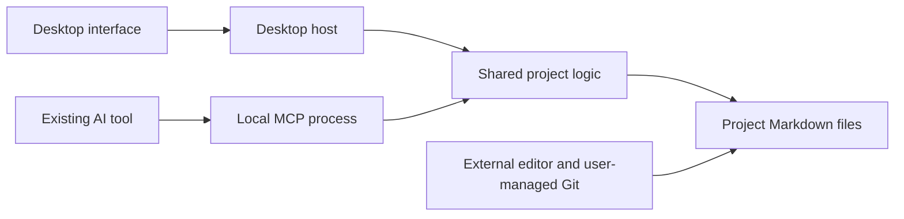

# Project Workspace — Technical Design

Status: Technical design v0.3, based on [Product Specification v0.18](project-workspace-spec.md). Electron, TypeScript, React, and Mantine are accepted stack choices. Supporting packages below are recommendations; other unconfirmed implementation details remain proposals. No application, dependencies, or prototype have been created.

## 1. Recommended architecture

Use a desktop app and a separately launchable local MCP server, sharing one library of project operations. Markdown files remain authoritative. Start with file reads and an in-memory index; a database, hosted backend, internal AI runtime, and always-running service are unnecessary for the initial workload.



The shared logic is a library loaded into two processes, not a new network service. It owns parsing, project boundaries, record validation, dependency readiness, change detection, and file writes. The desktop renderer receives narrow operations through the host; it does not receive unrestricted filesystem or shell access. Sanitize rendered Markdown/HTML, disable scripts from document content, and deny document-driven navigation or new windows. Resolve internal relative links through the validated project boundary; reject arbitrary `file:`, `javascript:`, `data:`, and custom-protocol links. Open only allowlisted HTTP/HTTPS external links on an explicit user action. These controls must cover both preview and editor rendering.

The MCP host launches the server through stdio and keeps the process alive for its connection. Each operation reads current project state; closing the desktop window does not affect that connection. This is the standard client-launched subprocess model described in the [official MCP stdio specification](https://github.com/modelcontextprotocol/modelcontextprotocol/blob/main/docs/specification/2026-07-28/basic/transports/stdio.mdx). Logs go to stderr. Do not implement protocol framing by hand; use an official SDK version verified against the chosen clients.

### Observing MCP status from the window (2026-09-19)

The window cannot see the server. The client owns the process and both ends of
the stdio pipe, so there is no handle, port, or channel the window could inspect.
The only thing the two processes reliably share is the project folder, so the
server records its own liveness there and the window reads it: a small JSON file
per session under `.projectspace/runtime/sessions/`, refreshed on a timer and
removed on a clean exit. It is coordination state like the write lock, excluded
from Git, and never project content.

Three separate facts come out of this, and the UI keeps them apart because they
can disagree and a user debugging a client needs to know which one failed:

| Fact | Evidence | What it does not prove |
| --- | --- | --- |
| Bundled runtime present | The window checks its own installed resources | That anything is running |
| Server process running | A session record with a current heartbeat | That a client ever connected |
| Client connection open | The server marked the record when the opening handshake ran | That the connection is still useful this second |

A heartbeat that has stopped makes a record *stale*, never *stopped*: it proves
the recording stopped, not that the client did. An unreadable folder reports
Unknown. Records abandoned by a killed process are cleared by the next server to
start, because reading status must never write to the user's project.

**Start and Stop are not offered, by design.** A server the window launched would
have no client on the other end of its pipes, so it could not serve anyone;
stopping the client's own process would sever a connection from outside the
client's knowledge and leave it believing the tool is still there. Both would be
theatre. The footer says the client owns the lifecycle and gives connection
guidance instead. Making the buttons real would need a different transport and a
long-lived service, which decision D-008 and section 1 deliberately rule out;
that is a bigger change than an indicator warrants.

A server bound to a folder that is not a project yet records nothing, because
creating the heartbeat directory would leave `.projectspace/` non-empty and make
`project_initialize` refuse the folder as somebody else's. The check runs on each
heartbeat rather than once at startup, so a project created through MCP becomes
observable within one heartbeat instead of needing the client to reconnect.

The cost of this approach is that only *our* server is observable. A client
running some other build against the same folder is invisible and reads as no
connection, which is why the wording is "no running server was observed" rather
than a claim about the world.

### Following links as built (2026-09-24)

Ticket db7cff48. A relative Markdown link is resolved in the renderer against the
file it is written in, which for a ticket is its real location,
`.projectspace/tickets/<id>.md`, not a placeholder. Percent-escapes are decoded
once; an escaped separator, a malformed escape, a backslash or a drive letter is
refused. The resolved path is then sent to the host (`resolveLinkDestination` in
core, `link:resolve` over IPC), which answers from disk: an included Markdown
document, a ticket file whose ticket exists, or `unavailable` with a reason
(outside the project, including through a symlink; another app record; not
Markdown; exists but not included; missing). The renderer never opens a path the
host did not confirm, and following a link reads only.

Images (2026-09-29, D-034, ticket 90e1db82) go through the same resolution. While
rendering, every image, Markdown or raw ``, becomes an inert placeholder
(`markdown-images.ts`, on an inert `DOMParser` document, before DOMPurify, which
then forbids `img` outright). An in-project path is sent to the host
(`readProjectImage` in core, `image:read` over IPC), which applies the link
boundary check (`resolveContentPath`, shared with `resolveLinkDestination`),
refuses `.projectspace/`, caps the size at 5 MB and decides the type from the
first bytes: PNG, JPEG, GIF or WebP, never SVG. The window receives a data URL,
which the page's `img-src 'self' data:` policy already allows, or a reason that
the placeholder then shows. Remote, protocol-relative, `data:` and absolute
sources are never sent to the host.

Headings carry GitHub-style ids with a `user-content-` prefix so a heading cannot
shadow a page property; fragments name the unprefixed slug, in the same file or
another. The destination heading is scrolled to and focused; a missing one leaves
the target readable from the top with a notice. A reply that arrives after the
user followed another link or switched project is dropped. One step back is kept
for the place the last link was followed from, offered only on that link's
destination; it is not browser history.

### Custom title bar (2026-09-25, D-030)

The window has no operating-system title bar. The first row of the header (48px) is
the title bar: the Knightbook mark, the project menu, search and Settings. Screens
with no project open show a strip of the same height with the mark and the product
name. The window keeps the platform's own controls. `titleBarStyle: 'hidden'` with
`titleBarOverlay` is set in `src/main/window/title-bar.ts`, and no title-bar library
or hand-drawn buttons are used.

| | Windows | Linux | macOS |
| --- | --- | --- | --- |
| Window controls | Native minimize, maximize and close, top right, drawn over the page in the app's colours | Native, top right; `symbolColor` is Windows-only, so the symbols follow the desktop theme | Native traffic lights, top left, moved to the middle of the row |
| Colours follow the scheme and dim when inactive | Yes, `setTitleBarOverlay` on theme change, focus and blur | Background only | Drawn by macOS |
| Safe area | `env(titlebar-area-*)` in shell.css | Same | Same (`titleBarOverlay: true`) |
| Checked | In the packaged app, 2026-09-25 | Not launched | Not launched |

Empty space in the row is `-webkit-app-region: drag`, and buttons, links and inputs
opt out. So the operating system, not the app, provides dragging, snapping,
double-click to maximize and the top resize edge. On Windows, `WM_NCHITTEST` on the
packaged window returned CAPTION for empty space, CLIENT for the name, search and
Settings, the native button codes for the three controls, and TOP for the upper edge.
Electron computes drag regions from the page without regard to what is drawn above
them, so anything layered over the row would move the window instead of taking the
click. Drawers therefore open below the row and dialogs keep at least 56px from the
top. The window title (`window-title.ts`) is still set for the taskbar, Alt+Tab and
the Dock, although no title text is drawn. The mark shown is a 96px derivative of the
approved logo, written by `derive:icon` beside the application icon (D-021). The
host copies the overlay colours from the page's stylesheets, and `title-bar.test.ts`
fails if they drift.

## 2. Accepted stack and supporting packages

The user accepted **Electron + TypeScript + React**, with a separately launched Node-based MCP host sharing the project logic. Milkdown remains the selected editor candidate, subject to the Markdown-preservation check. Desktop framework selection is settled; packaging is routine implementation and release-validation work.

The user accepted **Mantine** as the UI library, using its maintained components and a small theme/CSS layer. Its AppShell provides the main layout, Select supports searchable choices, and its theme centralizes colors, typography, spacing, and other visual decisions. Start with core components and hooks; add optional packages only when a feature needs them. [AppShell](https://mantine.dev/core/app-shell/), [Select](https://mantine.dev/core/select/), [theme](https://mantine.dev/theming/theme-object/)

| UI option | Assessment for this project |
| --- | --- |
| Mantine | Accepted: ready-made application controls with less locally maintained component code. Still requires deliberate layout and accessibility testing. |
| shadcn/ui | Good for owning and heavily customizing component source; that ownership adds local maintenance. Prefer it if bespoke component behavior becomes more important than using a maintained kit. |
| MUI | Broad component coverage with a Material Design baseline. A reasonable alternative, but Mantine is the better fit for the proposed visual flexibility and low-maintenance workflow. |

The comparison is a design judgment grounded in the projects' documented approaches: [shadcn/ui introduction](https://ui.shadcn.com/docs), [Material UI](https://mui.com/material-ui/). Do not install multiple UI kits or a second styling system for the initial shell. Use Mantine's theme and CSS modules for custom layout. Keyboard navigation, labels, focus management, and Kanban interaction still need testing.

Milkdown handles Markdown editing separately from the UI kit. Its GFM preset includes tables and related Markdown structures. Tiptap Markdown remains a fallback if the preservation experiment rules Milkdown out. Kanban drag-and-drop is handled separately, with dnd-kit recommended below. [Milkdown GFM preset](https://milkdown.dev/docs/api/preset-gfm), [Tiptap Markdown](https://tiptap.dev/docs/editor/markdown/getting-started/basic-usage)

### The public website (2026-10-01, D-042)

The website is a static [Astro](https://astro.build/) site in `apps/website`, a workspace package beside the desktop app. The user chose Astro on 2026-09-29, when the Website plan was ticketed, and it went in with ticket 1e8e5e3b. It fits the requirements in the [landing page proposal](proposals/landing-page-and-user-documentation.md):

- every page is HTML at build time, with no server;
- guides can be Markdown;
- no client-side JavaScript ships unless a component asks for it, so downloads and instructions work without JavaScript (proposal §8).

How it is built:

- **Layout.** The frame every page shares lives in `src/layout`: `BaseLayout.astro`, the header and footer, one navigation list, `tokens.css` and `base.css`. Pages live in `src/pages`, the folder Astro requires.
- **Narrow screens.** The header folds its links into a native `<details>` menu, which needs no script. Download stays outside the menu, visible at every width.
- **Tokens.** These are plain CSS custom properties. They are not Mantine: the desktop's component library is not shipped to a static site. The values follow `theme.ts` and `surfaces.css` (the `#5474b4` accent scale, the blue-grey surfaces, the system font stack). Dark follows the visitor's `prefers-color-scheme`.
- **Logo.** `docs/assets/knightbook-logo.png` is the only source. Astro's image pipeline (sharp) resizes it at build time for the header (1× and 2×) and the favicon.
- **Tests.** They build the whole site into a temporary folder and check the HTML a visitor would receive: no `<script>` and no `.js` file, a skip link first, the header links, the narrow-screen menu, and the 404 page. Checking the output is what proves the no-JavaScript requirement.
- **Releases.** Website-only merges do not release the desktop app (D-041).

### Supporting-package shortlist

These are feature-specific recommendations, not installed dependencies or a requirement to install everything at scaffolding. Resolve compatible versions together when implementing the relevant feature.

| Package | Purpose and boundary |
| --- | --- |
| `@dnd-kit/react` | Move and reorder Kanban cards. The current React API supports sortable interaction; add `@dnd-kit/helpers` only if its move helper is used. Pin the selected version and test keyboard movement plus multiple columns; provide a status control as an alternative to dragging. [Current quickstart](https://dndkit.com/react/quickstart/) |
| `@modelcontextprotocol/server` + `zod` | Official MCP server implementation plus one shared validation library for tool inputs and app-owned file records. Current SDK v2 supports Standard Schema; Zod v4 is our proposed choice, not a protocol requirement. Reuse validation across UI-host and MCP entry points. [Official SDK](https://github.com/modelcontextprotocol/typescript-sdk) |
| `yaml` | Parse YAML frontmatter and edit owned metadata fields through its Document API, retaining unknown fields instead of reconstructing a restricted object. Document serialization is not byte-preserving; keep untouched source bytes and test any deliberate rewrite. This library alone does not satisfy the Markdown-preservation requirement. [Document API](https://github.com/eemeli/yaml/blob/main/docs/04_documents.md) |
| `chokidar` | Refresh the desktop view after external edits and Git changes. Watch only relevant paths, coalesce events, and close watchers when a project closes. Atomic-save handling helps with editor saves, but events never replace revision checks or conflict handling. [Official README](https://github.com/paulmillr/chokidar) |
| `@tabler/icons-react` | One consistent icon set for navigation, ticket states, and editor controls. Import the icons actually used. [React documentation](https://docs.tabler.io/icons/libraries/react) |

Use **electron-vite** for desktop development/building and the already proposed **electron-builder** for distribution. They have distinct roles; verify the separate MCP build output is included as resources. [electron-vite guide](https://electron-vite.org/guide/)

Use **Vitest** for shared validation, transitions, dependency readiness, and filesystem/editor preservation tests. Consider **Playwright** for a small set of complete desktop workflows once the app runs; its Electron automation is explicitly experimental and does not replace packaged cross-platform checks. [Vitest](https://vitest.dev/guide/), [Playwright Electron support](https://playwright.dev/docs/api/class-electron)

For any renderer path that inserts generated HTML, **DOMPurify** is a sanitizer candidate to assess with Milkdown's actual rendering pipeline. Do not add a duplicate Markdown renderer solely to use it. Sanitization does not replace the link/navigation restrictions in section 1. [DOMPurify](https://github.com/cure53/DOMPurify)

React state is sufficient initially; defer a global state library until shared UI state makes it necessary. Keep simple text search and Node's filesystem, path, UUID, and hashing APIs. No database, ORM, AI-provider SDK, or separate UI styling framework is needed for the current design. Select locking/safe-write helpers during the filesystem experiment if native operations do not meet the defined behavior; this shortlist is not a complete dependency manifest.

### Packaged MCP: recommended simple path

Ship a platform/architecture-specific **Node runtime plus the compiled MCP server and required assets** as app resources outside Electron's ASAR archive. The AI client directly starts that runtime with the server path and project root as arguments. The user does not need a separate Node installation, running GUI, network listener, or background service. Electron-builder documents `extraResources` for executable tools and other runtime files, including their resource locations on each platform. [Application contents](https://www.electron.build/docs/contents/)

Illustrative client launch fields (not a universal client configuration or a command executed here):

```json
{
  "command": "<installed-resources>/mcp/node[.exe]",
  "args": ["<installed-resources>/mcp/server.mjs", "--registry", "<user-data>/mcp-access.json"]
}
```

Since 2026-09-22 the default names the access list of enabled projects (section 4);
`--root <selected-project>` in place of `--registry` is the older one-project form.

Use a compiled/bundled JavaScript entry point with any required runtime assets beside it. The shared TypeScript project logic is bundled into both applications; there is no need for a separate deployed service. Electron-builder is the proposed packager for this route, not an installed dependency.

Two alternatives are viable but unnecessary initially:

- **Reuse Electron's bundled Node:** `ELECTRON_RUN_AS_NODE` starts Electron in Node mode, provided its `runAsNode` fuse is enabled. This avoids shipping another runtime but couples MCP launch to Electron's executable, environment settings, and packaging flags. [Electron environment variables](https://www.electronjs.org/docs/latest/api/environment-variables), [fuses](https://www.electronjs.org/docs/latest/tutorial/fuses)
- **Node single-executable application:** embeds the bundled server into a Node executable. This can simplify the file layout, but the official documentation still labels the feature as active development. It is not required to ship a self-contained installer. [Node single-executable applications](https://nodejs.org/api/single-executable-applications.html)

The remaining checks are ordinary distribution details: choose the correct runtime for each target, preserve executable permissions and signing, keep the configured launch path valid across updates, and verify clean stdio/shutdown behavior with the GUI fully exited. For a Linux portable format with a transient mount path, install the helper at a persistent location or choose a stable installed layout; do not put a transient mount path into the client's saved configuration. The small cost of the simple route is an additional runtime to ship and maintain with app releases.

Exact dependency versions, OS versions, CPU architectures, and Linux package targets remain release decisions. Documentation establishes this packaging approach; an actual packaged build has not been tested yet.

## 3. Portable project storage

Propose one reserved folder, provisionally named `.projectspace/`. It contains app-owned Markdown records; existing documentation stays wherever it already lives in the repository.

```text
repository/
  README.md                         existing source document
  docs/architecture.md              existing source document
  .projectspace/
    project.md                      identity, included paths, board order
    tickets/<stable-id>.md           one canonical file per ticket
    plans/<stable-id>.md             one file per plan: phases referencing tickets (D-022);
                                     the board filters by them as view state only (D-035)
    documents/<stable-id>.md         metadata pointing to an existing document
    reviews/tickets/<ticket-id>/<reviewed-at>.md
    reviews/documents/<document path>/<reviewed-at>.md
                                     historical human-reviewed snapshots
```

Folder names are proposals. Project creation adds the reserved folder only when absent and never overwrites an existing unrelated directory. Initialize into a temporary staging directory, validate it, and publish it as a unit where supported; recover or report interrupted initialization explicitly.

- `project.md` has versioned YAML frontmatter for `schema_version`, a generated project UUID, name, included relative files/folders, and an optional `backlog_order` list of ticket IDs. Its Markdown body can hold a project introduction.
- Each ticket has a stable generated UUID independent of filename, title, and path. UI may abbreviate it when unambiguous. Avoid shared sequential ID counters across Git branches.
- Existing-document metadata holds its stable ID and project-relative path. It does not copy the live document body or modify the document's existing frontmatter just to register it. Manifest inclusion is authoritative for what appears in the workspace; listings can resolve included source files without metadata records.
- Review snapshots are historical evidence of what the user reviewed, not another editable source of current content. Create one on explicit human content review, not on every save. Preserve the source and enough metadata to identify the record, review time, and revision.
- Review history is split by kind and named the way the records themselves are, so one record's history is findable by reading the repository: a ticket's snapshots sit under `reviews/tickets/<ticket id>/`, and a document's under `reviews/documents/` followed by that document's own project-relative path as real nested folders. Nothing in the path is percent-encoded. A ticket id must be a single plain folder name and a document path must stay inside `reviews/documents/`; a record id that cannot satisfy that is refused rather than written somewhere else. Because reviews of documents are keyed by path, renaming or moving a document still loses its review history — stable document ids remain a separate decision.
- Store local checkout paths, window position, and recent-project preferences outside the repository as disposable app state. These are not project content and need not be Markdown. Runtime locks and temporary saves are likewise non-authoritative.

### Showing a ticket's id as built (2026-09-24)

The ticket dialog shows the id as its first eight characters, in the quietest style in the header, with the full id in a tooltip and on the copy control's accessible name. Eight characters is the form this project's own notes already use to name tickets, and it is the start of the filename in `.projectspace/tickets/`, so it can be read aloud and matched by eye. What is copied is always the whole id, because `depends_on` and the MCP tools take nothing shorter. So an abbreviation that ever collided could mislead a reader but could never reach another tool. Copying reports success, and says so when the clipboard refuses.

`documents_include` updates only the manifest. Create per-document metadata later when an operation needs a stable document reference or review record, under the shared write lock. Find an existing mapping by canonical in-project path before creating one; repeated registration is idempotent. Persist metadata before emitting its stable ID or writing a ticket link to it. An interruption can leave unused metadata, but must not make included source files disappear. Report invalid/missing source paths without deleting metadata or touching the sources. Do not make manifest inclusion depend on successful creation of a second file.

Use relative paths within project records. Resolve and validate real paths at runtime; reject traversal, symlinks/junctions escaping the selected root, and invalid platform filenames. Detect case-colliding paths before claiming portability. Never execute scripts or commands from project frontmatter. Preserve unknown metadata fields and refuse unsupported schema versions without rewriting files.

Git operations remain external. Detect conflict markers and invalid records, preserve their bytes, and show an actionable problem. App writes to invalid records stop until the user resolves them. Rebuild views after external changes; do not infer a different branch is synchronized or approved.

### Document folders and their titles as built (2026-09-25)

The Documents list groups included files into the folders they really sit in. The tree is derived from paths on every read and stores nothing: a folder appears only because an included document is inside it, so inclusion, `includedVia`, removal scope and overlap deduplication are exactly what they were. Root files stay at the top level.

A folder's title, such as "Documentation" for `docs`, is a sparse `folder_titles` map in `.projectspace/project.md`, keyed by normalized project-relative folder path, as the user chose on 2026-09-21. It is written key by key through the YAML document, so other manifest fields and unknown metadata survive. The path goes through the same boundary checks as inclusion, and the folder must exist when a title is set. A title never renames anything. A title whose folder was renamed or deleted outside the app is reported as missing and kept until the user clears it. A malformed map reads as no titles, so the project still opens; writing a title over one is refused rather than replacing it. MCP's `documents_list` returns the titles, so an AI tool sees the same names. Setting them is the app's job for now.

Which folders are collapsed is this window's view state, kept in the renderer's local storage per checkout path. It is never written to the project. Collapsed folders are what is stored, so new folders and a first visit start open. Selecting a document, including through a link, expands every folder above it.

Mantine's Tree was evaluated first, as the ticket asked. In 9.6.1 its nested nodes set no `aria-expanded`, Enter does nothing, and only the first node is ever in the tab order. Rather than patch around those gaps, the list follows the disclosure pattern WAI-ARIA recommends for navigation. Each folder is a button with `aria-expanded` and `aria-controls`, each document a button with `aria-current`, and Tab, Enter and Space do the rest. Naming a folder is a separate, labelled button beside it.

## 4. Project selection and checkout identity

Persist a logical project UUID in `project.md`. A clone or worktree retains that UUID, but each local checkout has its own canonical root path and current files. Never silently combine two checkouts because their project UUID matches.

### One shared connection for enabled projects (revised 2026-09-22)

The original design bound each MCP connection to one root (`--root <folder>`), which
meant a separate client entry per project. That mode still exists unchanged, but new
setup uses **one shared connection** for every project the user explicitly enables.
The transport does not change: it is still the client-launched stdio process with the
bundled Node runtime. No HTTP endpoint, listener, hosted backend or always-running
service is introduced. Each client (or each chat, if a client starts one per chat)
launches its own process from the same configuration; "one connection" means one
configuration, not one process.

**Launch.** `node server.mjs --registry <user-data>/mcp-access.json`. The flag names the
access list, not a project, so the copied configuration never changes when projects
are enabled or disabled. `--root` and `--registry` together are refused rather than
one being picked.

**The access registry.** A JSON file in the desktop app's user-data folder (outside
every repository), separate from the recent-project list, which is capped, evicts and
ignores write failures. Each entry is a grant: an opaque random `checkout_id`, the
canonical checkout path, the project UUID and name found there when enabled, and when.
Only the user adds an entry, with **Allow AI access through MCP** in the app's MCP
panel; opening a folder or its being in recent projects grants nothing. Entries stay
until the user turns the setting off. Writes take a lock file beside the registry and
replace it through a temporary file. A file that is missing means nothing is enabled;
a file that cannot be parsed, fails validation, has an unknown schema version or holds
duplicate ids or paths is reported as `registry_unreadable`, grants nothing, and is
never overwritten — a guess could lose grants or broaden them.

**Targeting.** On a shared connection every project tool requires `checkout_id`, and
`projects_list` returns each enabled checkout's `checkout_id`, `project_id`, name,
canonical path, availability and any other enabled checkouts of the same project. On
every call the server re-reads the registry, finds the entry, and checks that the
folder still exists at the same canonical path and still holds the same project UUID.
It refuses with `checkout_not_enabled` (unknown or revoked id), `checkout_unavailable`
(folder missing or moved, records gone or unreadable) or `checkout_mismatch` (the path
now resolves elsewhere, or holds a different project). It never falls back to the last
project used, never accepts a filesystem path as authority, and never rebinds a moved
folder to another checkout sharing its UUID or name — clones and worktrees share both,
which is why the path and the id, not the name, identify a checkout. There is no
server-side "current project": concurrent calls each carry their own target, and the
desktop's visible project plays no part. Every response on a shared connection carries
a `project` block (checkout id, project id, name, path) so the caller can verify where
it acted. After resolution, the existing boundary checks, per-checkout write lock,
revisions, completion provenance and user-only Done rules apply unchanged.

**Revocation.** Checked at the start of each operation. Turning access off blocks the
next call from any running connection without the client reconnecting. An operation
already past its check finishes; project writes replace files through a temporary file
under the lock, so finishing cannot leave a file half-written.

**Initialization.** A shared connection does not offer `project_initialize`. The app
enables only a project it can open, so its identity is known when granted; a folder
whose records later disappear is reported as unavailable. Creating a project stays an
explicit act in the app (or on a root-bound connection, in the folder it was launched
for), so no tool call can pick a new path.

**Status.** A shared server heartbeats beside the registry (`mcp-runtime/sessions/`),
not in any project, because running says nothing about which project it is working
on. When a call targets a project it leaves a small activity record in that project's
Git-ignored `.projectspace/runtime/activity/`, at most every few seconds and removed on
clean exit. The footer keeps the facts apart: a project-bound server connected here
reads **MCP connected**; a shared client connected while this project is allowed reads
**MCP available**, with observed use reported separately ("last worked on this
project 2 minutes ago", counted only from a session still alive); a shared client
connected while this project is not allowed reads **MCP not allowed here**.

**Compatibility.** `--root` configurations keep working exactly as before and are never
widened: they register no `projects_list`, take no `checkout_id` (one supplied is
ignored), and still offer `project_initialize`. Moving to the shared connection is the
user's step (README, "Moving from one entry per project"); the app never edits a
client's configuration or removes its old entries.

Proposed interfaces from the research note (`projects_list()`, `ticket_list({ checkout_id })`,
`ticket_read({ checkout_id, id })`) are what shipped. MCP Roots are not used for this:
they are informational, not an access-control boundary.

## 5. Ticket state and ordering

Suggested frontmatter fields: `schema_version`, `id`, `title`, `status`, `depends_on`, `created_at`, `updated_at`, `related_documents`, optional blocker details, and optional completion provenance. The body stays Markdown for the description, acceptance criteria, implementation notes, and handoff information. A template suggests headings; the app must not require particular prose headings to display the ticket.

Use four status values: `backlog`, `in_progress`, `verification`, `done`. Keep content-review information separate. A ticket with no prerequisites is dependency-ready; otherwise every prerequisite must be in Verification or Done. Missing references, duplicate IDs, and cycles prevent the affected ticket from being suggested as eligible and produce an explanation. A write through `updateTicket` may not add a self-dependency, an unknown ticket, or a prerequisite that leads back to the ticket (D-032, `tickets/dependency-change.ts`); references already in a file are reported this way, not refused. For the board, `summarizePrerequisites` (in `tickets/dependencies.ts`) splits readiness into the prerequisites still unmet and whether all are met, apart from a blocker or a cycle; the card's "Waiting on N" and "Unlocked" badges read it (D-033).

`backlog_order` in the project manifest defines manual order. Tickets absent from that list follow deterministically by creation time and stable ID. Creating a ticket therefore needs only one new file; it need not also update a shared counter or order file. Reordering edits only the manifest. Report duplicate/unknown order entries without deleting ticket content.

The next-ticket query returns the first Backlog ticket in that order whose prerequisites satisfy readiness and which has no explicit blocker or invalid record. It does not reserve or start it. On the user's request, the external agent reads its linked context and changes it to In progress. Revalidate eligibility at that mutation. One active AI session per project is the initial usage assumption; there is no automatic execution queue.

If a prerequisite fails verification, persist an issue on that prerequisite and derive an affected-work flag for dependent tickets. Existing downstream statuses stay intact. Proposed default: do not suggest new affected work until the prerequisite is corrected or the user explicitly resolves the issue. This failure flag takes precedence over a still-Verification status. Direct overrides and reopening Done tickets need explicit transition rules during implementation design.

### Creation order in a burst as built (2026-09-20)

"Deterministically by creation time and stable ID" was deterministic but not the
order anyone meant. `created_at` has millisecond resolution, so creating several
tickets at once — an AI filing a handful at the end of a conversation — puts more
than one in the same millisecond on a machine with a fast disk, and the sort fell
through to the stable id, which is a random UUID. The tickets then appeared in an
order nobody chose. It surfaced twice as a CI failure that reproduced only on the
fastest runner, first in `ticket-search.test.ts` and then in
`backlog-order.test.ts` on the rule itself.

`createTicket` now issues a creation time strictly later than the previous one it
issued in this process, so a burst is strictly increasing and the existing
comparison does the rest. The cost, stated rather than hidden: a ticket created in
a burst carries a timestamp up to a few milliseconds after the instant it was
written. That buys a record whose order matches the order the tickets were made
in, which is what anyone reads it for.

Two processes creating tickets in the same millisecond can still tie, and still
fall back to the id. That is rare, deterministic, and left alone.

### Failed-prerequisite transitions as built (2026-09-20)

The issue lives in an optional `verification_issue` on the prerequisite's own
frontmatter: the user's `reason`, plus the same provenance triple `completion`
carries, so an AI-reported failure is stored as `reported_user_instruction` and
never as a direct user action. Recording it is valid only from Verification, and
it leaves the ticket in Verification: failing is a flag on the work, not a move
backwards through the board. Reopening a Done ticket stays out of scope and keeps
its own open decision.

The affected-work flag is derived on every read rather than written onto
dependents, which is what keeps the promise that no downstream record changes.
The walk is transitive and cycle-safe: a ticket is affected when any prerequisite
it rests on has an unresolved issue, even when the prerequisite between them sits
in Verification. Resolving the issue is a separate user decision and clears every
dependent at once. Both operations exist as MCP tools and as direct actions in the
app; the agent-facing ones require the same explicit assertion completion does,
and neither can be set or cleared through a general `ticket_update`.

### Reopening a Done ticket as built (2026-09-20)

The rule this section asked for. Moving a ticket out of Done through an ordinary
`ticket_update` is reopening it, and it takes back the acceptance recorded on it.
The `completion` block is removed and appended to an optional
`previous_completions` list, oldest first, carrying everything that was known
when the decision was made plus `reopened_at` and the `reopened_to` status that
ended it.

Archived rather than deleted, because both halves of the record have to stay
true. Leaving `completion` in place says a Backlog ticket is accepted work;
deleting it says the user never accepted it. The list is history and nothing
reads it as state: readiness, selection, review and the unattributed check all
ignore it. Re-accepting a reopened ticket goes through Verification and
`ticket_record_user_completion` exactly as the first acceptance did, so a ticket
can hold several archived decisions and one current one.

Three cases follow from that and are tested. An update that does not change
status leaves a Done ticket's acceptance alone — editing a Done ticket is not
reopening it. A Done ticket with no provenance has nothing to archive, so it
reopens with no history and stays unattributed while it is Done. Nothing else on
the record changes: reopening is a statement about acceptance and about nothing
else.

Reading is gated on status in both surfaces. The board and the MCP tools report a
current `completion` only when the ticket is Done, so a file edited by hand or
merged from a branch that carries an acceptance beside a contradicting status is
not repeated as a claim. The app shows the archived decisions in the ticket
detail, worded in the past, and never on a card.

### Archiving

Archiving keeps the working board manageable without losing the record. It is
housekeeping, not a step in the workflow, and it decides nothing about the work.

The metadata is an optional `archived: { archived_at }` on the ticket, and
nothing else. Deliberately **not** a fifth status: every existing consumer of the
four treats status as where the work stands, and a fifth value would make each of
them answer "archived" to a question about progress. Keeping `status` untouched
also means the retained status and the real status are the same field, so they
cannot drift, and restoring is removing the metadata rather than replaying a
remembered value. Its absence means active, which is what every ticket written
before archiving existed already says, so no migration is needed.

Archiving changes nothing else on the record: the file stays where it is under
its own id, with its body, links, dependencies, completion provenance and review
snapshots intact. Restoring a Done ticket therefore does not reopen it — the
acceptance is neither re-asserted nor withdrawn — and restoring an unfinished one
does not accept it. `archived` joins `status` in the review fingerprint's
bookkeeping set, so filing a ticket away cannot cost a real review its evidence
while a substantive edit made while archived is still detected.

What archived tickets stop doing is being offered as work: they leave the board's
columns and counts, are counted separately, and are never proposed by
`ticket_next`. They remain readable by id, and searchable under an explicit
scope. An archived prerequisite keeps whatever meaning its status already had —
Verification or Done still satisfies a dependency, because archiving did not undo
it, while an unfinished one still blocks and says it was archived, because
archiving did not finish it.

Bulk archiving a column is a sequence of independent writes, each with the
revision the user was shown, not a transaction across files. The set is captured
when the confirmation is accepted, so tickets created afterwards are not swept
up, and the result reports how many were archived and names the ones that were
not. Partial success is a real outcome and is reported as one.

## 6. Human completion through the existing AI tool

Keep completion separate from ordinary status mutation. A dedicated `ticket_record_user_completion` operation requires the current ticket revision, an assertion that the user explicitly instructed completion, and a brief description of that instruction. It is valid from Verification. The app can also record completion through a direct user action.

Record the decision source separately from the recorder. For example, an agent-recorded update says `decision_source: reported_user_instruction` and `recorded_by: agent`; it must not pretend to be a direct UI action. Store a timestamp and the accepted ticket revision. Keep test results as supporting information, not authorization. Avoid storing entire conversations just to record completion.

The server can validate transition structure and require the explicit assertion. It cannot independently prove the conversation occurred or prevent a file-writing agent from changing Markdown directly. This is a cooperative workflow rule backed by provenance, not a tamper-proof approval system. The companion instructions must clearly prohibit self-certification. A second approval in this app is not part of the design.

Generic ticket/document mutations must not bypass the completion operation, including attempts to create a new ticket already marked Done or edit managed frontmatter through a body-update tool. External Done edits with missing or inconsistent provenance are displayed as externally changed/unattributed; do not invent approval, silently change their status, or erase the user's files. A forged matching assertion remains outside the guarantee of this local design.

## 7. Meaningful changes and review history

Use two separate comparisons:

- **Raw revision:** a hash of exact file bytes used for stale-write detection. Formatting differences must still cause a write conflict if a caller read older bytes.
- **Review comparison:** structured Markdown content and relevant metadata compared with the last reviewed snapshot. Known representation-only changes can be ignored here. Code text, link destinations, headings, substantive frontmatter, and acceptance criteria must remain significant.

No-op opens never save. Ticket status, ordering, and bookkeeping timestamps do not by themselves invalidate review of its intended work. A user completion decision does not automatically review linked documents.

Deterministic parsing can identify some formatting equivalence; it cannot reliably distinguish every typo correction, rephrasing, or change of intent. Proposed handling: ignore known formatting-only changes, show unclassified changes against the previous reviewed version, and allow the user or cooperating external AI to explain their significance. Meaningful changes set content to Unreviewed while preserving the prior snapshot. Do not show unclassified current content as fully human-validated merely because an older revision was reviewed.

This classification behavior needs a short prototype review: it is the main unresolved product-sensitive detail. Do not add an embedded model, paid classification service, or assume an AI-provided label is infallible. The source diff remains available for inspection.

### Changes since review as built (2026-09-24)

Ticket 5be60610. Documents and tickets have a read-only **Changes since review**
view beside the rendered one. It compares the current file with the source kept
in the most recent readable snapshot, never with Git HEAD or the previous save,
and opening it records nothing.

The comparison lives in core (`review-changes.ts`) and runs in the desktop host;
the renderer receives numbered lines and draws them as text, so markup in a
document is shown exactly as written and never rendered. Frontmatter and body are
compared as two sections, so a metadata edit cannot hide among prose. A changed
frontmatter line under one of the fields review already ignores (`status`,
`updated_at`, `created_at`, `completion`, `blocker`, `archived`) is labelled
bookkeeping. That list is now one exported constant used by both the fingerprint
and the view, so the two cannot disagree. The view also reports whether review
status counts the edits, using review status's own rule; the fingerprint
semantics did not change.

Each outcome is explicit. No readable snapshot is "no review to compare against",
not a comparison with an empty document. Snapshot files that exist but cannot be
read are counted and reported, and left on disk. Line-ending and final-newline
changes, which a line view cannot draw, are listed as notes. Inputs over 20,000
lines or 1,000,000 characters, or two versions needing more than 5,000 edits or
1.5 seconds to compare, get an explanation instead of a line comparison.

**Reviews now name the revision that was shown.** `recordReview` and the app's
two review operations take an optional expected revision, and the app always
sends one: the rendered revision in Read, the compared revision in Changes, the
board's revision from a card. Content that changed since is refused with
`revision_conflict` and the view reloads, so a review cannot approve an edit that
landed while the user was reading. The MCP surface is unchanged; it cannot record
reviews at all.

The line comparison uses the `diff` package (jsdiff) for its array diff with an
edit-length and time bound, as the 2026-09-21 research recommended. Per D-019 it
is a supporting package added for this feature, not a user-approved dependency.

### Line endings (2026-09-25, D-025)

Line endings are not content. `contentFingerprint` normalises CRLF and lone CR to
LF before parsing, so a body's paragraph breaks survive in either style. Review
status and the changes view both call `unchangedSinceReview`, which accepts the
current file when its bytes match the reviewed revision, when the same content in
LF matches it or the retained snapshot source, or when its fingerprint matches the
stored one or one recomputed from that snapshot source. The recomputation is what
lets reviews stored before this change, whose fingerprint was taken over CRLF
bytes, match again without migrating any file. The raw revision in write.ts is
untouched, so a file rewritten on disk still conflicts before any write.

## 8. Saving without losing work

All desktop-host and MCP mutations call the same write path:

1. Resolve the target inside the bound project and acquire a short per-checkout write lock shared by app and MCP processes. Keep this temporary coordination outside Git-tracked content.
2. Re-read the target and compare its exact revision with `expected_revision`; create operations require the path to be absent.
3. Validate schema and transition rules. For dependency-sensitive writes, re-read related records under the same app/MCP lock.
4. Save through a temporary file in the target directory and replace using the platform-supported safe operation. Release the lock after success or failure; report errors without truncating the original.

Return the new revision and a concise description of the applied change. Reads return revision tokens. A stale write returns the latest revision and a conflict result so the caller can re-read; it must not silently retry by overwriting newer content.

External editors and Git do not honor these locks. Rechecking files reduces races but does not create a universal filesystem transaction. Watchers trigger refreshes; they are not proof that a buffer is current. A dirty editor shows a conflict and preserves the unsaved buffer. Prototype rapid external saves, rename/replace behavior, and a crash during save before claiming no-loss behavior.

An earlier layout stored every snapshot in one flat folder named after a percent-encoded record id (`reviews/ticket%3A…`, `reviews/document%3Adocs%2F…`). Projects carrying that history keep it: both layouts are read, the latest review is the newest across the two, and the app never moves, renames, or rewrites an old folder. New snapshots only ever go to the layout above, and opening a project still writes nothing.

This project's own history was moved into the new layout by hand on 2026-09-20 — 33 record folders, 39 snapshots, every file byte-identical and recorded in Git as a pure rename. That was a one-time tidy-up of this repository, not something the app does. The dual-read stays: other checkouts, older branches, and anyone else's project may still hold the old layout, and reading it costs nothing.

Favor single-record operations. For a review snapshot, write the self-contained snapshot first; derive the latest review from valid snapshots rather than requiring an atomic pointer update elsewhere. For other future multi-file actions, define recovery before exposing them. Do not build a general transaction engine in advance.

## 9. Initial MCP surface and workflow guidance

These are proposed operations, not finalized tool schemas:

| Operation | Purpose |
| --- | --- |
| `project_initialize` / `project_get` | Initialize the selected root or retrieve its identity and compact context index. |
| `documents_include` | Register selected in-root documents/folders in place. |
| `document_read` / `document_write` | Read original Markdown plus revision, or save with a revision precondition. |
| `document_create` | Create a new `.md` document at a project-relative path and include it; never overwrites (D-023). |
| `project_search` | Bounded text/title search across included docs and tickets. |
| `ticket_list` | List filtered tickets, dependency reasons, or the next eligible candidate. |
| `ticket_create` / `ticket_update` | Create or update task content and ordinary lifecycle fields with validation. |
| `ticket_record_user_completion` | Record the user's explicit completion instruction with honest provenance. |

The minimal read surface returns metadata/snippets by default and full content on request. Ticket reads include direct document references and prerequisite statuses. Use simple text search initially; add embeddings only if measured retrieval failures justify them. Managed metadata is changed through validated record operations, not unrestricted whole-file writes.

Ship portable Markdown workflow guidance, with a skill package for clients that support it after validation. It explains: read context, distinguish observed facts from assumptions, choose/start work only when asked, leave results in Verification, record Done only on explicit user instruction, and preserve useful handoff notes. An MCP connection does not itself enforce that behavior. Keep guidance distinct from project evidence and data-validation rules.

### Shipping the workflow skill as built (2026-09-24)

The packaged app carries `skills/projectspace/` in `extraResources` as `resources/skills/projectspace/`, copied straight from the repository folder so there is one source. A packaging test compares the shipped folder with the source file by file. In development the host reads the repository copy directly.

**Set up your AI tool** in the MCP panel installs into the four folders the clients document, re-checked on 2026-09-24: Claude Code's `~/.claude/skills/projectspace` and `.claude/skills/projectspace`, and Codex's `~/.agents/skills/projectspace` and `.agents/skills/projectspace`. The renderer names a target by id; the host resolves every path. Each target reads as absent, matching, outdated, or modified.

- **Outdated needs evidence.** When Knightbook installs a folder it records the folder's content hash in `app-state.json` (`installedSkills`). A folder that differs from the shipped skill but still matches that hash is an unedited old install, and may be updated after the user confirms. Any other difference is reported as modified and never overwritten, because an older version and the user's own edits cannot be told apart without the record. Losing `app-state.json` therefore makes old installs read as modified, which errs toward not overwriting.
- **The state is re-checked at write time**, so a folder edited after the dialog showed it is refused. New folders are built beside the target and moved into place, so a client never loads a half-written skill.
- **Export** writes a new `projectspace` folder into a folder the user picks and refuses if one is already there. **Copy skill text** covers clients without skills.
- **A file on disk is not activation.** The dialog says it can confirm placement only; whether a client loaded the skill is visible only in the client.

### Header search covers documents (2026-09-25)

Ticket bd3357e9. Ctrl/Cmd+K searches tickets and the workspace's included documents, shown under two headings. The document half is core's `searchDocuments` (`document-search.ts`), and it reads documents through `readSearchableDocuments`, the same scan `searchProject` (MCP `project_search`) now uses, so both agree on which documents exist, which are over the 512 KB scanning bound, and which could not be read. `project_search` output is unchanged. The highlight helpers the ticket search already had moved to `search-text.ts` so both kinds of hit are matched and marked the same way.

Tickets and documents are separate host operations with separate limits (20 each), answered side by side: one failing leaves the other's results on screen and names which failed, and each group says "No ticket contains" or "No document contains" on its own. Documents are not searched in the Archived scope, because documents are never archived; the dialog says so. Like `project_search`, a document is matched on its whole file, frontmatter included, so an excerpt can begin in the frontmatter.

### MCP configuration per client (2026-09-25, D-026)

**Copy MCP configuration** opens a choice of client, and each choice copies a complete entry built by `mcpClientSnippets` in `apps/desktop/src/shared/mcp-client-config.ts` from the existing `McpLaunchCommand`. No contract operation was added. Checked against each client's documentation on 2026-09-25:

- **Claude Code and Claude Desktop** (code.claude.com/docs/en/mcp): JSON `{ "mcpServers": { "knightbook": { "type": "stdio", "command", "args" } } }`, for `.mcp.json`, `~/.claude.json` or `claude_desktop_config.json`. The `claude mcp add … -- <command>` line is not offered: a command line has to be quoted for the user's shell, and PowerShell, cmd and POSIX shells quote paths with spaces differently.
- **Codex** (learn.chatgpt.com/docs/extend/mcp, redirected from developers.openai.com/codex/mcp): TOML `[mcp_servers.knightbook]` with `command` and `args`, in `~/.codex/config.toml` or a project's `.codex/config.toml`. Strings are TOML literal strings, so Windows backslashes need no escaping; a path containing `'` falls back to an escaped basic string.
- **OpenCode** (opencode.ai/docs/mcp-servers and /docs/config): JSON `{ "mcp": { "knightbook": { "type": "local", "command": [program, ...args], "enabled": true } } }`, in `~/.config/opencode/opencode.json` or a project's `opencode.json`. OpenCode merges its config files.
- **Another client** gets the plain `command` and `args`, as before.

After copying, the panel says which file the entry goes in and that an existing server list should be merged, not duplicated. A refused clipboard write is reported as nothing copied. These formats belong to the clients and can change without notice; three plus a fallback keeps that exposure small.

## 10. Formatted editor boundary

Keep the source file as the canonical document. Retain original bytes, separate any existing frontmatter without rewriting it, and parse only for display/editing. Use one editor candidate initially.

- Support a declared CommonMark/GFM subset first: headings, lists, links, fenced code, tables, and other syntax proven by the fixture tests.
- Do not serialize on load or save merely because the editor normalized its internal representation.
- On deliberate edits, preserve unrelated content and original metadata. If a library rewrites too much, it fails the fixture rather than redefining the requirement.
- Detect unsupported constructs before editable rendering. Show a readable fallback and an Open in external editor action when lossless saving cannot be established. Never silently drop HTML, directives, extensions, or unknown blocks.
- Keep a built-in source editor optional. The external-editor fallback is sufficient for the initial experiment.

Unsupported-content detection itself must be tested. A parser producing an AST does not establish that the editor can serialize that content safely.

### Opening a ticket's file as built (2026-09-24)

Tickets get the same external-editor handoff as documents: **Edit externally** in the ticket dialog, beside the ticket's details rather than among Review and Accept, because opening a file is not a decision about the work. The renderer sends only the ticket id. The host accepts a plain id with no separators, builds `.projectspace/tickets/<id>.md`, confirms it is inside the tickets folder, and reads it through the project boundary before handing it to `shell.openPath`. A failure the shell reports is shown in the dialog.

The file is read as raw text, not parsed as a ticket. A record broken by conflict markers or an unsupported schema is exactly the one a person most needs to fix by hand, and refusing it would send them looking for a UUID filename. Existence and containment are still proven. Returning to the window refreshes the ticket through the ordinary focus refresh; an outside edit never records a review or acceptance.

### Preservation research evidence

Upstream reports confirm that content-preservation failures have occurred. This is issue/documentation research, not a reproduction against our selected package versions:

- **Inline line breaks removed:** issue #2428 reports `foo<br>bar` becoming `foobar` with preset-commonmark 7.21.3. The issue is closed and fix #2463 was merged August 29, 2026. Verify the selected release includes it rather than treating the historical report as an unfixed limitation. [Report](https://github.com/Milkdown/milkdown/issues/2428), [merged fix](https://github.com/Milkdown/milkdown/pull/2463)
- **Autolink backslashes multiply:** issue #2349 reports repeated parse/save cycles doubling certain backslashes inside autolink URLs with Crepe/transformer 7.20.0. Both Milkdown's issue and the linked underlying serializer issue were open when checked. This is a specific URL edge case, not evidence that all links are affected. [Milkdown report](https://github.com/Milkdown/milkdown/issues/2349), [upstream report](https://github.com/syntax-tree/mdast-util-to-markdown/issues/73)
- **Inline code altered while typing:** issue #2446 reports emphasis input rules consuming literal characters inside code spans on 7.22.0. Loading the same complete Markdown worked; incremental typing triggered the bug. Fix #2445 was merged August 8, 2026. Include typing interactions alongside import/export checks. [Report](https://github.com/Milkdown/milkdown/issues/2446), [merged fix](https://github.com/Milkdown/milkdown/pull/2445)

Milkdown documents conversion through Remark AST and ProseMirror, plus configurable stringify options. These support controlled output formatting, not a documented guarantee of byte-identical source preservation. [Architecture](https://milkdown.dev/docs/guide/architecture-overview), [FAQ](https://milkdown.dev/docs/guide/faq)

Recommendation: keep Milkdown as a candidate and test these exact cases, frontmatter, tables, code, and unsupported extensions against the chosen version/configuration. Preserve frontmatter outside the editable body where appropriate. Distinguish harmless Markdown normalization from changed content or meaning; exact unrelated whitespace preservation should be evaluated as a separate usability goal. This research does not approve a relaxation of the existing product requirements or select a replacement editor.

## 11. Validation before building out the product

| Experiment | Required evidence |
| --- | --- |
| Independent packaging | On Windows, macOS, and Linux, invoke the bundled Node/server through the saved client command with the GUI fully exited and no system Node dependency. Read/write a fixture project, reconnect, and confirm the configured path survives an app update. |
| Markdown preservation | No-op open is byte-identical. A small supported edit preserves existing frontmatter, code, tables, links, and unrelated text. Unknown syntax survives or saving is explicitly blocked. |
| Safe writes | Stale app/MCP writes conflict; dirty UI buffers survive external edits; failures preserve original files. Document residual races with uncooperative external writers. |
| Review classification | Formatting-only edits retain review; meaningful changes require renewed review; ambiguous edits remain visible without claiming current human validation. |
| Completion and dependencies | Generic writes cannot self-certify Done; explicit user instructions can be recorded. Verification unlocks dependents; failed prerequisites flag affected work without resetting it. |
| Portable checkout | Clone/open the same project at a new path; preserve identity, selected docs, review history, and board state while keeping checkout bindings separate. |
| Inclusion and rendering | Interrupt inclusion/registration between writes: included files stay visible and repeated registration does not duplicate IDs. Verify unsafe links/HTML cannot execute or navigate, while validated internal links remain usable. |

These checks have not run. Use a small editor-preservation experiment and a packaging smoke test as early implementation work, then implement one vertical slice: initialize project → create ticket → implement externally → Verification → user instruction → Done. Add the remaining Mantine UI around that verified path. The packaging test verifies a known distribution pattern; it is not a reason to reopen the accepted desktop stack.

## 12. Next decisions

For deferred distribution work, see [releases after merge](proposals/release-automation.md):
current packaging evidence, tooling alternatives, a proposed GitHub Actions
build-and-publish sequence, and release acceptance criteria. No workflow is
enabled by that proposal.

The base stack and Mantine are accepted. Supporting packages remain recommendations to add as their features are implemented. Review the proposed reserved Markdown-record layout, then choose how to present ambiguous review changes. Other details can be refined through implementation checks without another long product questionnaire. The product spec remains authoritative wherever this proposal leaves a choice open.
